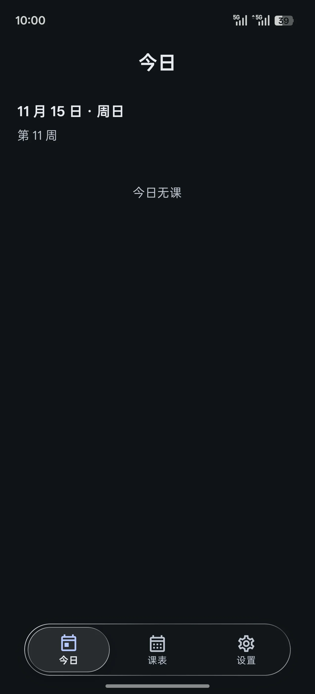
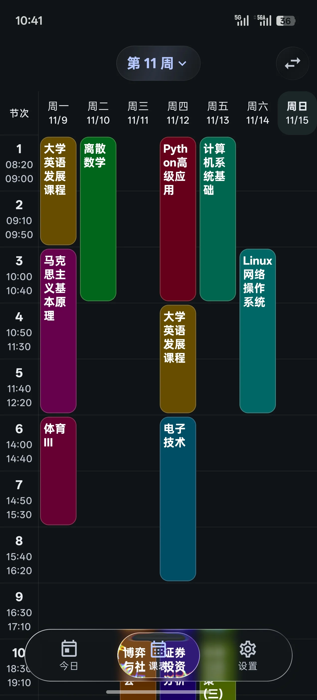
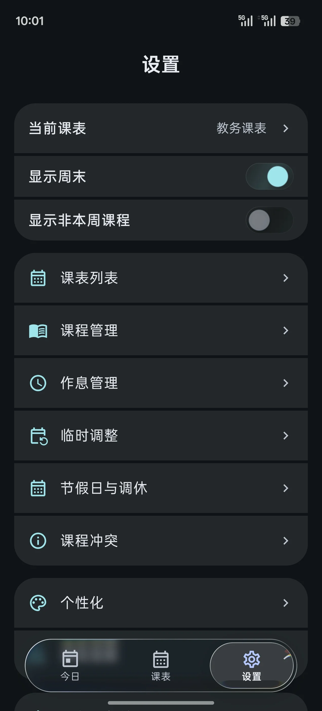

# 青鸾课程表

一款简洁、轻量的 Android 本地课程表。无需注册应用账号，课表保存在设备上，支持教务导入、多课表管理和液态玻璃导航栏。

**Android 15+ · Kotlin / Jetpack Compose · v1.0.1（内部版本 101）**

[下载安装](https://github.com/wangshiyulin/qingluan-schedule/releases/latest) · [官网](https://schedule.qingluanx.com) · [问题反馈](https://github.com/wangshiyulin/qingluan-schedule/issues) · [博客](https://qingluanx.com)

## 功能

- **今日与周课表**：滑动切周、多课表切换，显示课程名、教师和教室；已结束的今日课程淡化并划线。
- **课程与作息管理**：点击课表空白区域添加课程，支持单双周、不连续周、多时段和批量设置作息。
- **临时安排**：调课、停课、补课、节假日与调休；发现冲突后可定位到对应周。
- **教务导入**：本科/专科、研究生、通用三个入口，支持学校搜索、手动网址和多来源提取；导入前核对课程数量、周次、教师及地点。
- **导入与备份**：文件、分享口令、二维码导入；单课表导出、完整备份、本地自动备份、历史恢复与撤销最近修改。
- **课程提醒**：提前提醒、通知与后台运行状态、下一次提醒和测试通知。
- **个性化**：浅色、深色及系统动态配色；字号、课程间距、圆角、透明度和对齐方式；可拖动实时预览与自选启动页面。

## 软件预览

<table>
  <tr><th>今日</th><th>课表</th><th>设置</th></tr>
  <tr>
    <td></td>
    <td></td>
    <td></td>
  </tr>
</table>

## 导入与导出

| 格式 | 导入 | 导出 | 内容 |
| --- | --- | --- | --- |
| 原生 JSON、分享口令、二维码 | ✓ | ✓ | 单课表，含临时调整及节假日调休 |
| CSV / TSV | ✓ | CSV | 周期课程 |
| Excel（XLSX）| ✓ | ✓ | 周期课程 |
| HTML | ✓ | ✓ | 课表表格及周期课程 |
| ICS | ✓ | ✓ | 日历事件；本应用往返保留原生课表数据 |
| PNG / PDF | 二维码图片 | ✓ | 当前教学周的课表图片或文档 |
| 完整 JSON / ZIP 备份 | ✓ | ✓ | 全部本地课表与设置 |

教务目录包含 **214 所学校、230 个 HTTPS 入口**。目录提供导航入口，不代表已经逐校完成兼容性验证。登录后请打开完整学期课表再提取，并核对课程、教师、教室和作息；网站未加载的数据无法凭空补齐。旧课表缺失的字段需要重新导入。

网页解析在本机完成。不同教务系统的页面结构、跨域框架或验证码可能影响识别，遇到问题可改用 Excel / HTML 等文件导入。不支持任意截图 OCR 或其他软件的私有云端口令。

## 备份与提醒

课表修改前默认创建本地自动备份，可保留 3、5 或 10 份。自动备份保存在应用私有目录，卸载应用前请导出完整备份。

课程提醒需要通知权限；系统省电策略可能影响准时送达，可在提醒页面检查权限、后台状态并发送测试通知。

## 构建

使用 Android Studio 打开项目，或通过 Gradle Wrapper 构建。

- JDK **21**
- Android SDK **37.2**，Build Tools **36.0.0**
- 最低 Android **15 / API 35**，目标 API **37**

```bash
# 调试安装包
./gradlew assembleDebug

# 发布安装包（需要自行签名）
./gradlew assembleRelease
```

Windows 使用 `gradlew.bat` 替代 `./gradlew`。

输出目录为 `app/build/outputs/apk/`。发布构建默认生成未签名 APK；请保管自己的签名密钥，后续更新使用同一签名。源码包不含签名私钥、密码、本机 SDK 路径或构建缓存。

## 技术栈

Kotlin、Jetpack Compose / Material 3、Coroutines / Flow、Room、DataStore、AndroidX WebKit、Jsoup、ZXing 与 Backdrop。

## 许可与致谢

第三方组件、图标、配色和学校入口数据的署名及许可证见 [THIRD_PARTY_NOTICES.md](THIRD_PARTY_NOTICES.md)、[licenses](licenses) 与 `app/src/main/assets/licenses/`。

第三方组件遵循各自许可证。应用图标由项目作者提供。
